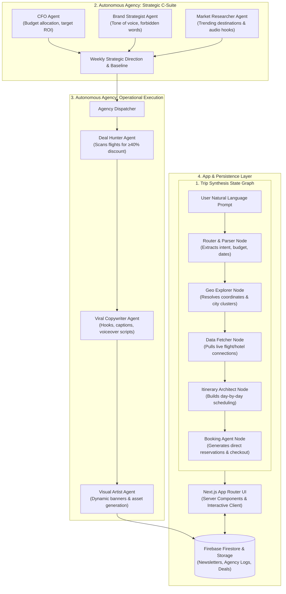

# ✈️ TravelGraph — Autonomous Multi-Agent Travel Orchestration & Marketing Agency

[](https://nextjs.org/)
[](https://www.typescriptlang.org/)
[](https://tailwindcss.com/)
[](https://firebase.google.com/)
[](https://opensource.org/licenses/MIT)

> **Stateful multi-agent system combining real-time trip synthesis graph with an autonomous C-Suite & Execution marketing agency for algorithmic travel deals and content generation.**

---

## 🇮🇹 Executive Summary (Italiano)

**TravelGraph** è una piattaforma di orchestrazione viaggi e marketing turistico interamente basata su **architettura ad agenti autonomi cooperativi (Multi-Agent State Graph)**, sviluppata con **Next.js (App Router)** e **TypeScript**.

La piattaforma risolve due problemi strutturali del settore turistico:
1. **Pianificazione Viaggi Dinamica:** Un grafo a nodi sequenziali analizza in linguaggio naturale le preferenze dell'utente, risolve le coordinate geografiche, estrae le tariffe in tempo reale e genera itinerari ottimizzati giorno per giorno con link di prenotazione.
2. **Agenzia di Marketing Autonoma (Autonomous AI Agency):** Un comitato direttivo simulato (C-Suite Agents: CFO, Brand Strategist, Market Researcher) stabilisce ogni settimana le linee guida di spesa (ROI target), il tono di voce e le destinazioni in trend, delegando a una squadra operativa (Execution Agents: Deal Hunter, Viral Copywriter, Visual Artist) la ricerca di tariffe aeree scontate (\(\ge 40\%\)) e la generazione di copy e asset visuali per campagne virali.

---

## 🏛️ System Architecture



---

## ⚡ Technical Highlights

1. **Stateful Graph Orchestration (`src/lib/agents/graph.ts`):**
   - Implements predictable state transitions where each node receives a typed `TravelGraphState`, executes async tools, appends structured logs, and returns partial state deltas.
2. **Role-Separated Agentic Architecture:**
   - Strict separation between executive governance (`c-suite/`) and tactical execution (`execution/`), preventing hallucinations and maintaining strategic budget control.
3. **Full-Stack Next.js 15 Integration:**
   - API route handlers for cron-triggered agency execution, webhooks, and modern glassmorphic UI styled with Tailwind CSS.

---

## 🚀 Quickstart

### 1. Requirements
- Node.js >= 18.0.0
- npm >= 9.0.0

### 2. Installation
```bash
git clone https://github.com/GabriMannino-pt/TravelGraph.git
cd TravelGraph
npm install
```

### 3. Environment Variables
Create a `.env.local` file with the required Firebase and API keys:
```bash
cp .env.example .env.local
```

### 4. Run Development Server
```bash
npm run dev
```
Open [http://localhost:3000](http://localhost:3000) to interact with the multi-agent graph planner.

---

## 📁 Repository Structure

```
TravelGraph/
├── src/
│   ├── app/                     # Next.js App Router (pages, api, crons)
│   ├── lib/
│   │   ├── agents/              # Multi-Agent Core Engine
│   │   │   ├── c-suite/         # CFO, Brand Strategist, Market Researcher
│   │   │   ├── execution/       # Deal Hunter, Viral Copywriter, Visual Artist
│   │   │   ├── agencyState.ts   # C-Suite State Machine definition
│   │   │   ├── agents.ts        # Node definitions
│   │   │   ├── graph.ts         # User Trip Graph Orchestrator
│   │   │   └── state.ts         # User Trip State Machine definition
│   │   ├── firebase.ts          # Firebase backend client
│   │   ├── newsletter.ts        # Automated deal distribution
│   │   └── share.ts             # Social sharing hooks
├── public/                      # Static assets & icons
└── README.md                    # Enterprise architectural documentation
```

---

## 👨‍💻 Author
**Gabriele Mannino**  
- Software Engineer & Automation Architect  
- LinkedIn: [linkedin.com/in/gabriele-mannino-dev](https://linkedin.com/in/gabriele-mannino-dev)  
- GitHub: [@GabriMannino-pt](https://github.com/GabriMannino-pt)  
- Email: `gabri.mannino.lavoro@gmail.com`
